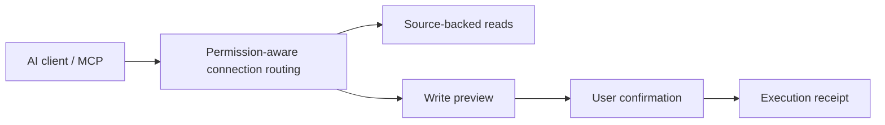

# Feishu MCP — Documents, Sheets, Calendar & Tasks for AI Workflows

Copyright © 2026 cyuanxv · [Twitter / X: @cyuanxv](https://x.com/cyuanxv) · MIT License

**Self-hosted live-service package:** see [installation and your own Feishu OAuth](standalone/README.md). Root `server.json` describes this package; the synthetic preview draft is under `distribution/server.preview.json`.


**Give your AI a workspace worth working in.**

A TypeScript MCP server project that brings Feishu document search, spreadsheets, Bitable, calendars, tasks, meeting-room booking, and cloud attachment workflows into AI-assisted work. Reads retain sources. Writes require review and confirmation. Execution returns receipts.

[中文](README.md) · [Setup](snapshots/sites-adapter-0.1.0-sites.8/docs/SETUP.md) · [Validation](VALIDATION.md) · [Follow @cyuanxv on X](https://x.com/cyuanxv)

**MIT licensed · self-hosted preview · bring your own app and authorization**

This is an unpublished source candidate, not a hosted service or a plug-and-play marketplace listing. Bring your own application, permissions, deployment, and compatible MCP/OAuth host.

## What you can build

- Find authorized messages, documents and knowledge-base content with traceable sources.
- Create spreadsheets, add worksheets, write cells, and adjust font colors, merged cells and column widths.
- Read Bitable schemas and records, and prepare reviewed writes.
- Query calendars and availability; prepare meeting-room bookings for confirmation.
- Read, create, update and complete tasks through reviewed workflows.
- Download authorized attachments and traverse folders in the cloud, with per-file outcomes and ZIP output.

Multi-application routing selects connections by actual permissions. Confirmation and receipts make writes inspectable, and uncertain outcomes are not blindly replayed.

## Architecture



## Get started

Use Node.js 24 LTS. From the repository root:

```sh
npm ci --ignore-scripts
npm run typecheck
npm test
npm run build
npm run smoke:production
npm run check:source
```

The root runtime is an early Node/PostgreSQL implementation with a loopback-only synthetic demo. For the current cloud adapter, see `snapshots/sites-adapter-0.1.0-sites.8/` and its [setup guide](snapshots/sites-adapter-0.1.0-sites.8/docs/SETUP.md). It requires trusted host identity and DB/BUCKET bindings; it is not a generic Worker deployment with authentication already solved.

## Evidence and limits

Local regression, installation tests and real authorization are recorded separately. Real authorization, refresh and reading one dedicated test document passed in an isolated private environment; this does not validate every business operation. Online document exports and real nested chat-folder cases still require separate acceptance. Lark international compatibility has not been verified. See [validation details](VALIDATION.md).

This project is independent of Feishu/Lark and OpenAI. It includes no original deployment credentials, private service binding or old Git history.

## Follow the build

Follow [@cyuanxv on Twitter / X](https://x.com/cyuanxv) for development notes and workflow demos. Once publicly released, useful issues, contributions and stars are welcome.

## Local distribution preview / 本地发行预览

See [distribution/README.md](distribution/README.md) for the synthetic-only stdio package and Registry publication boundaries. This is not a live Feishu connector.

## Self-hosted service

Start with the [installation guide](standalone/README.md). Use your own Feishu app, HTTPS origin, authorization and storage. No author credentials, private data or production endpoint are included. See [real authorization acceptance](standalone/LIVE-ACCEPTANCE.md) for the exact tested scope. The synthetic demo remains optional and is not the live-service entrypoint.
