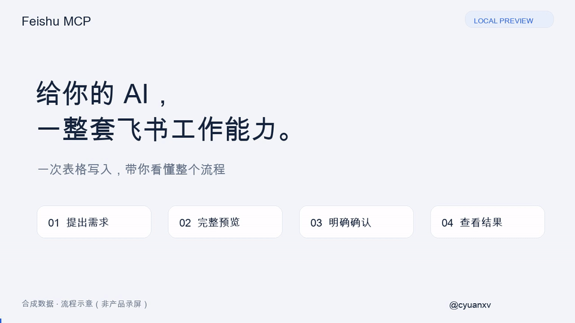
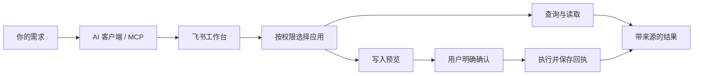

# Feishu MCP — 飞书 MCP Server for ChatGPT

版权所有 © 2026 cyuanxv · [Twitter / X：@cyuanxv](https://x.com/cyuanxv) · MIT 许可证

**已发布：`0.1.0-local.4`（预览版）** · [npm 安装包](https://www.npmjs.com/package/@cyuanxv/feishu-mcp-standalone) · [MCP Registry 官方登记](https://registry.modelcontextprotocol.io/v0.1/servers/io.github.cyuanxv%2Ffeishu-mcp-standalone/versions/0.1.0-local.4)

**真实服务独立安装版：** 请先看 [安装与自己的飞书授权](standalone/README.md)。根目录 `server.json` 对应此版本；旧合成预览配置在 `distribution/server.preview.json`。

**第一次安装？** 从[中文安装教程：应用、HTTPS、授权与首次读取](docs/INSTALL.zh-CN.md)开始。


**给你的 AI，一整套飞书工作能力。**

从搜索文档、整理表格，到安排日程、预订会议室：把分散在飞书里的工作接进 AI 对话。查询有来源，写入先确认，执行有回执。

Feishu MCP is a TypeScript MCP server project for Feishu workflows: documents, spreadsheets, Bitable, calendars, tasks, meeting rooms, and cloud attachments.

[English](README.en.md) · [配置指南](snapshots/sites-adapter-0.1.0-sites.8/docs/SETUP.md) · [验证记录](VALIDATION.md) · [Twitter / X：@cyuanxv](https://x.com/cyuanxv)

> [当前预览版说明](https://github.com/cyuanxv/feishu-mcp-server/releases/tag/v0.1.0-local.4)：包含尚未完成的真实验收范围。

> **预览版 · MIT · 自托管**。使用自己的飞书应用、授权和存储；不包含作者的私人服务或数据。各项检查的日期、数量与限制见 [验证记录](VALIDATION.md)。

## 32 秒看懂：写入前先确认

**合成数据 · 流程示意，非产品录屏。** 提出需求 → 预览目标与内容 → 明确确认 → 模拟回执与回读核对。演示没有连接飞书，也没有执行真实写入，不能作为功能验收证据。



[观看 / 下载完整 MP4](docs/media/workflow-demo.mp4) · [使用自己的应用开始安装](standalone/README.md) · [已验证与待验收范围](RELEASE-CHECKS.md)

## 飞书自动化，从一句需求开始

以下是可围绕现有工具构建的工作流示例，不是对任意 AI 客户端的一键兼容承诺。

| 你想做的事 | 工具如何帮忙 |
|---|---|
| “找到项目文档和相关讨论，给我原始来源。” | 搜索消息与文档，读取授权范围内的内容，保留来源和权限边界 |
| “把这份整理好的数据写入电子表格。” | 创建表格、新增工作表、写入明确区域；确认后执行，再回读核对 |
| “看看这个时段有什么会议室可用。” | 查询忙闲和会议室；选定房间及时间后生成预订预览 |
| “把这些后续事项建成任务。” | 准备任务内容，预览确认，再返回执行结果 |
| “下载这条群消息里的附件或文件夹。” | 在有访问权限时云端下载，返回逐项结果和 ZIP；不把部分成功说成全部成功 |

## 一套工作台，接起你的飞书工作流

| 领域 | 源码包含的能力 |
|---|---|
| 联系人和消息 | 人员与群聊查询、消息搜索、消息线程 |
| 文档和知识库 | 搜索、内容读取、评论；文档创建与更新预览 |
| 电子表格 | 创建、新增工作表、单元格读写、字体颜色、合并拆分、列宽 |
| 多维表格 Bitable | 数据表与字段查询、记录读取、受控记录写入 |
| 日程和会议室 | 日程查询、忙闲分析、时间建议、会议室预订流程 |
| 任务 | 任务查询、创建、更新与完成 |
| 云端文件 | 附件下载、文件夹遍历、逐项结果和打包；在线导出代码及待验收边界见下文 |

**多应用自动选权限。** 同一账户绑定多个应用后，按实际授权选择连接；无权限会明确说明。

**写入的每一步都看得见。** 完整预览、明确确认、执行回执，处理未知结果时优先核查，避免盲目重复提交。

**检查结果有据可查。** 本地自动化、独立安装与真实授权分别记录，不把模拟上游测试当作真实业务验收。详见 [验证记录](VALIDATION.md)。

## 从需求到结果，一张图看懂



*能力流程示意图，不是真实产品截图；执行仍受实际授权、资源权限和宿主接入限制。*

## 谁适合用

- 想让 AI 访问授权范围内飞书资料、辅助处理日程和表格的个人开发者。
- 正在搭建团队内部 MCP 工作台，需要多应用权限管理和写入确认机制的工程团队。
- 希望研究飞书 API、OAuth、云端文件下载与可验证执行流程的开发者。

## 先选对入口

- **推荐独立安装入口**：`standalone/`，使用自己的应用与授权；先看 [安装说明](standalone/README.md)。
- **云端适配器实现**：`snapshots/sites-adapter-0.1.0-sites.8/`。目录名称为兼容保留；版本以 package.json 为准。需要可信宿主身份、DB 与 BUCKET 绑定。
- **本机合成演示与早期 Node 实现**：根目录 `apps/`、`packages/`。默认演示仅监听本机，不是生产认证服务。
- **通用 Agent 工作流说明**：`skills/feishu-workflows/`，不含既有插件绑定。

## 从 npm 安装完整服务

建议使用 Node.js 24，支持 Node.js 22+。先创建自己的安装目录并设置依赖修复，再安装已发布的预览版：

```sh
mkdir feishu-local && cd feishu-local
npm init -y
npm pkg set overrides.miniflare.undici=7.29.1 overrides.miniflare.sharp=0.35.5
npm install --ignore-scripts @cyuanxv/feishu-mcp-standalone@0.1.0-local.4
```

接着按 [完整安装与授权指南](standalone/README.md) 配置自己的飞书应用、HTTPS 地址和授权，再连接 MCP 客户端。Registry 登记的是同一个自托管安装包，不提供公共托管入口；不能跳过初始化直接运行。安装后的全新目录回验和原有验收边界见 [发行检查](RELEASE-CHECKS.md)。

## 本地检查

建议使用 Node.js 24 LTS、npm。安装命令只安装锁定依赖；不需要飞书账号或密钥。

```sh
npm ci --ignore-scripts
npm run typecheck
npm test
npm run build
npm run smoke:production
npm run check:source

cd snapshots/sites-adapter-0.1.0-sites.8
npm ci --ignore-scripts
npm run typecheck
npm test
npm run check:package
npm run check:source
npm ci --ignore-scripts --prefix runtime-check
npm run check:workerd
```

## 自建环境

参见云端适配器的 [配置说明](snapshots/sites-adapter-0.1.0-sites.8/docs/SETUP.md)。该适配器依赖宿主提供的已验证身份与 DB/BUCKET 绑定，不是任意 Worker 上无需适配即可运行的公开服务。不要直接信任客户端自行提供的身份头。

## 验证边界

自动化测试使用合成上游响应；通过测试不等于新租户的权限审批、真实业务数据或线上部署验收已完成。在线文档/表格导出仍须独立验证实际应用的导出权限与文件访问权限；原生文件夹已在所有者本人会话专用样本完成真实下载；本发行包通过合成上游独立安装回归，不能扩大为所有群聊权限场景均通过。Node 原生 PostgreSQL、浏览器交互及容器检查以各自运行记录为准。

完整服务安装包已在 npm 发布，并在 MCP Registry 登记，版本为 `0.1.0-local.4`。源码构建仍默认保留误发布保护；CI 只检查和打包，不会自动更新 npm、Registry 或部署服务。

## 常见问题

### 这是飞书官方 MCP 吗？

不是。这是独立项目，不代表飞书、Lark 或 OpenAI 官方。采用 MIT 许可证，保留原始版权声明。

### 能直接在 ChatGPT 里安装使用吗？

本项目提供源码与 npm 自托管安装包，不提供托管服务或已审核的 ChatGPT 目录插件。需自行部署、注册应用并授权，再在支持相应 MCP/OAuth 能力的客户端接入；具体宿主仍需验收。

### 支持 Lark 国际版吗？

当前实现主要面向飞书。Lark 的域名、权限和租户差异须单独适配与验收，本包不宣称已完成国际版兼容。

### 在线文档导出和群聊文件夹下载都已完全验证了吗？

下载和在线导出代码已经包含；在线 DOCX/PDF、XLSX/CSV 导出仍有真实授权与数据验收边界，原生文件夹的原名与三级空目录已通过专用样本验证；不同群聊的访问权限仍需使用者核实。请以配置指南和验证记录为准。

## 跟进项目

由 [@cyuanxv](https://x.com/cyuanxv) 分享开发进展、工作流演示和踩坑记录。欢迎关注 Twitter / X，告诉我你最想交给 AI 的飞书工作。

如果这个项目帮到了你，欢迎 Star、提交 Issue 或贡献代码。

## 可选合成演示

[合成演示包](distribution/README.md) 仅用于协议演示，不连接真实飞书；需要真实功能请使用独立安装版。

## 独立安装版 / Self-hosted service

[独立安装与授权说明](standalone/README.md)：使用自己的飞书应用、HTTPS 地址和用户授权运行完整服务；不带作者的数据、密钥或生产入口。与合成预览包不同，独立版直接调用飞书 API。已在独立私有环境完成真实用户授权与专用测试文档只读验收，范围见 [真实验收记录](standalone/LIVE-ACCEPTANCE.md)。
